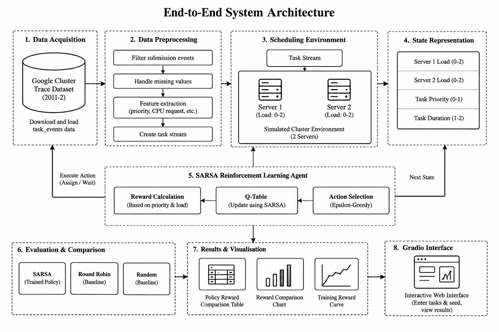

# Dynamic Task Scheduling Using SARSA-Based Reinforcement Learning

## Project Overview
This project demonstrates dynamic task scheduling using the State-Action-Reward-State-Action (SARSA) reinforcement learning algorithm. It uses a selected portion of the Google Cluster Data 2011-2 task-events dataset and a simulated environment containing two servers.

The agent observes the current remaining workload of both servers and the characteristics of the incoming task. It then chooses to assign the task to Server 1, assign it to Server 2, or wait/defer. The trained SARSA policy is compared with Round Robin and Random scheduling.

## Objectives
- Process selected Google Cluster Trace task-event data.
- Build a simplified two-server scheduling simulation.
- Train a SARSA agent to make scheduling decisions using rewards.
- Compare SARSA with Round Robin and Random baselines.
- Display decisions and evaluation results through a Gradio interface.

## Dataset
**Google Cluster Data 2011-2**  
Source: https://github.com/google/cluster-data

The notebook downloads a selected task-events data shard directly. It uses fields such as timestamp, priority, CPU request and memory request. In this implementation, CPU request is used as a proxy to classify tasks into short and long categories; it is not the actual task execution duration.

## System Architecture


## Technologies Used
- Python
- Google Colab / Jupyter Notebook
- Pandas
- NumPy
- Matplotlib
- Gradio
- SARSA reinforcement learning

## Scheduling Actions
| Action | Description |
|---|---|
| 0 | Assign task to Server 1 |
| 1 | Assign task to Server 2 |
| 2 | Wait / Defer |

## Workflow
1. Download and preprocess the selected Google Cluster Trace data.
2. Convert task records into the task stream used by the simulator.
3. Create a simulated environment with two servers.
4. Represent server workload and incoming-task characteristics as the state.
5. Train the SARSA agent using an epsilon-greedy action-selection strategy.
6. Evaluate SARSA against Round Robin and Random scheduling.
7. View scheduling decisions and comparison results in the Gradio interface.

## How to Run
1. Open `Dynamic_Task_Scheduling_SARSA_Google_Cluster_Trace.ipynb` in Google Colab.
2. Run the notebook cells in order from top to bottom.
3. Allow the notebook to download and process the dataset when prompted by its code.
4. Complete training and evaluation.
5. Launch the Gradio interface from the notebook and try the demonstration.

## Project Files
```text
Dynamic-Task-Scheduling-SARSA/
├── Dynamic_Task_Scheduling_SARSA_Google_Cluster_Trace.ipynb
├── system_architecture.png
├── README.md
└── requirements.txt
```

## Limitations
- The environment simulates two identical servers; it does not schedule jobs on a live production cluster.
- CPU request is used as a simplified duration proxy because the selected task-event records do not directly provide actual execution duration.
- The waiting action and reward design are simplified for this prototype.
- Results depend on the selected trace records, simulation assumptions and evaluation settings.

## Author
**Rithanya M**  
B.Tech – Computer Science and Engineering (Artificial Intelligence and Machine Learning)
